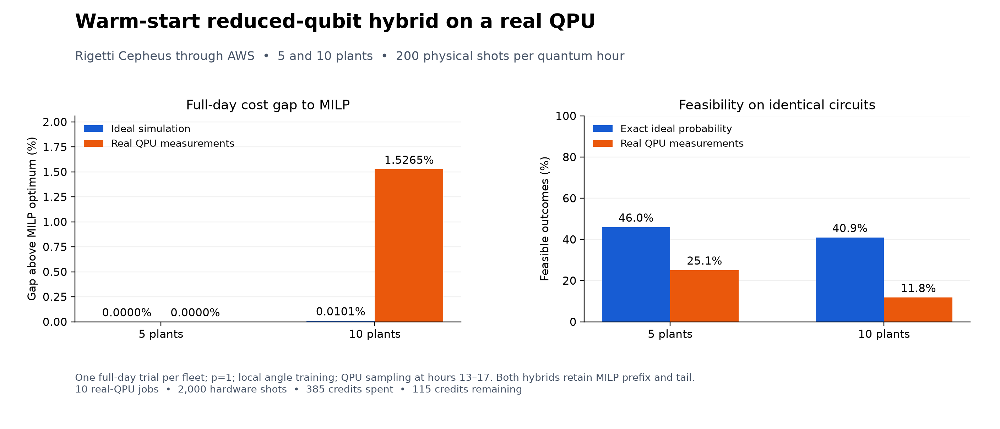

# Warm-start reduced hourly method: real hardware demonstration

| Plants | Ideal daily gap | Hardware status | Hardware daily gap | Hardware feasible shots |
|---:|---:|:---|---:|---:|
| 5 | 0.0000% | COMPLETED | 0.0000% | 251/1000 |
| 10 | 0.0101% | COMPLETED | 1.5265% | 118/1000 |

Device: `aws:rigetti:qpu:cepheus-1-108q`. This is the selected greedy-warm-start p=1 reduced hourly QAOA with biased initialization and its matching mixer. Angles are selected from six candidates using 256 local simulated training shots each; final candidates are measured on the real QPU under the user's 500-credit instruction and a tighter 385-credit execution cap. Demand, reserve, min-up/down locks, economic dispatch, datasets and the MILP reference match the ideal simulation. Both schedulers retain the initial full-day MILP and conditional tail. No solar, wind, block refinement, unsampled repair or post-hoc bit reversal. AWS-path counts use classical bit 0 on the right, as documented by qBraid.

The daily-gap bars compare independent complete trajectories with the same protocol. The feasibility bars compare hardware measurements against exact ideal probabilities for the very same hardware circuits/histories. One trial per fleet does not estimate repeated-run reliability. Invalid or unfinished days have no reported cost gap.

## Submission plan

Up to 10 jobs: five sequential quantum hours per fleet, 200 shots each. Current quote: 38.50 credits/job, maximum 385.00 qBraid credits. No extra paid calibration/training jobs; no automatic paid retries. Each new submission checks the price and the approved cumulative ceiling. Existing job IDs are resumed instead of resubmitted. A failed or infeasible hardware result remains a failure.

Raw counts, payloads, source/data hashes, settings, job IDs and costs are saved in `experiment.json` and per-job files. `submission_plan.json` records the plan before hardware submission.

Sources: [qBraid AWS execution and bit ordering](https://docs.qbraid.com/v2/sdk/user-guide/providers/aws), [Rigetti submission paths](https://docs.qbraid.com/v2/sdk/user-guide/providers/rigetti).

## Verified execution and billing

All ten jobs completed on the real Rigetti QPU. Independent replay verified all 2,000 raw hardware shots, the cost-preserving reduced encoding on observed samples, both full-day schedules, and that every selected quantum-hour row occurred in the actual QPU counts. No failed outcome was replaced by a simulated or unsampled choice.

Provider-reported charges total **385 credits**. The account balance after completion was **115 credits**. `provider_execution_evidence.json` records the service-confirmed device, completion state and timestamps; each job also has its native compiled Quil program and readout mapping.

| Plants | Ideal full-day gap | Real-QPU full-day gap | Feasible QPU samples |
|---:|---:|---:|---:|
| 5 | 0.0000% | 0.0000% | 251/1000 |
| 10 | 0.0101% | 1.5265% | 118/1000 |

The 5-plant hardware schedule matches the MILP optimum. The 10-plant hardware schedule is valid but more expensive than its ideal-simulation counterpart. Hardware returned fewer feasible candidates on the identical circuits; finite sampling and hardware imperfections can affect these results. This single pilot does not isolate every error source or establish quantum advantage.

For presentation: **A warm-start reduced-qubit hybrid produced valid schedules on a real Rigetti QPU, achieving 0% and 1.53% gaps to MILP for 5 and 10 plants, respectively.**
