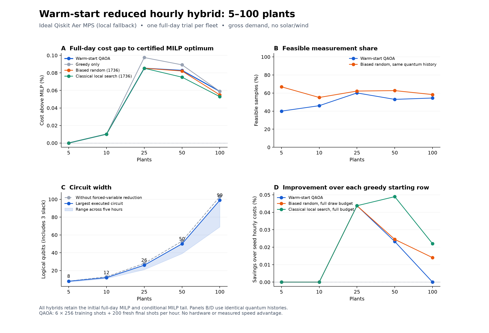

# Warm-start reduced hourly scaling pilot

Completed 5/5 valid full-day quantum hybrid schedules on **Qiskit Aer MPS (local fallback)**. QPerfect MIMIQ validated the small warm-start circuit, but its 30-circuit large training batch remained queued for more than ten minutes. This completed pilot uses local Qiskit Aer MPS, under a 2 GiB address-space limit and one simulation thread. It is not a completed MIMIQ scaling result. This is a **single-trajectory pilot per fleet**, not a seed sweep or proof of quantum advantage. There is one fleet instance at each size; the lines do not establish asymptotic scaling.

| Plants | Valid whole day | Warm QAOA gap | Executed qubits | Feasible final shots | Full MILP wall time |
|---:|:---:|---:|---:|---:|---:|
| 5 | yes | 0.0000% | 7–8 | 400/1000 | 0.060 s |
| 10 | yes | 0.0101% | 11–12 | 460/1000 | 0.098 s |
| 25 | yes | 0.0853% | 21–26 | 601/1000 | 0.303 s |
| 50 | yes | 0.0828% | 39–50 | 530/1000 | 0.817 s |
| 100 | yes | 0.0590% | 69–99 | 545/1000 | 1.154 s |

## What was actually executed

- Fleets: [5, 10, 25, 50, 100]; quantum hours 13–17; original gross load/reserve; no solar/wind; no ramp constraints.
- Exact removal of only forced on/off plant decisions. All remaining bits stay variable. No fleet grouping or exponentially sized large-fleet statevector.
- A classical merit-order heuristic creates a feasible hourly seed without seeing the optimal MILP row for that hour. Each free plant has flip probability min(0.15, 1/free plants); three slack bits have flip probability 0.15.
- A p=1 warm-start circuit uses biased Ry preparation, nonzero QUBO phase evolution, and a matching rotated mixer. The quantum contribution is the distribution of fresh observed candidates and their classical evaluation.
- Six fixed nonzero angle pairs, 256 training shots per pair; feasibility-aware selection; 200 fresh final shots. Training samples and the greedy seed are never substituted as quantum outcomes. Failed final sampling stops the trajectory.
- MPS bond dimensions 64 for training and 128 for final shots; one 256 check (identical saved counts to bond 128: True). Aer does not provide a global fidelity estimate; inspect the saved bond-dimension check. Truncation threshold was 1e-12, with caps 64/128/256. This is ideal simulation, not hardware accuracy.

## Fair interpretation

The warm-start mechanism is a greedy-seed adaptation of [warm-start QAOA](https://arxiv.org/abs/2009.10095), not that paper's relaxation-based implementation or its guarantees.
The original hybrid's **initial full-day MILP is retained**, and supplies hours 0–12. All methods use the same prefix and solve a conditional MILP tail after hour 17. Therefore, these are not MILP-free schedules or evidence of reduced total work versus MILP. Baseline data for the unexecuted middle rows is not passed to the greedy initializer or circuit.

Controls include greedy alone, independent biased sampling from the exact same warm-start probabilities (200 and 1736 draws), and classical improving one/two-plant local search (1736 proposals). Full-day controls have their own evolving histories; the additional conditional controls in panels B/D use each quantum history exactly. The total-budget control counts all QAOA training plus final shots; this is an evaluation-count comparison, not equal runtime or equal computational effort. A gamma=0 circuit exactly reproduces the biased product distribution, verified locally and on MIMIQ for 5 plants. The completed scaling pilot repeats that small-instance validation on its own backend.

The CSV records how many quantum hours strictly improved their own greedy seed; an observed seed returned unchanged is a valid quantum sample but is not a quantum improvement.

The original three-slack-bit QUBO and approximate operating-cost surrogate are retained. Slack represents only 0–350 MW; this may be inadequate at large scale. True feasibility and dispatched operating cost are checked separately. Warm starting does not fix that modeling limitation. Increasing qubits/circuit density can still make a deeper or larger MPS simulation costly.

## Timing, cost, and reproducibility

Total experiment wall time: **323.7 s (5.4 min)**, including small validation, controls, submission/execution, and verification during the run. For the local fallback, this excludes earlier cloud queue waiting and development time. Sum of recorded execution batch wall times: 269.0 s. 12 execution batches; 51792 simulator shots; reported simulator cost **0.0 credits**. The local fallback also records per-circuit transpilation/simulation timings; these are not physical QPU times or complete per-method wall times. Cloud batch timings cannot be divided into per-fleet runtimes. Classical timings include common layout setup and should not be treated as tuned solver benchmarks.

Saved: `pilot.json`, `prespecified_policy.json`, pre-final angle choices, all OpenQASM circuits, raw measurement counts, `summary.csv`, PNG/PDF/SVG chart, and `independent_validation.json`. Independent replay checked 25 full-day schedules and that all selected quantum rows were cheapest feasible **fresh final samples**. Source/data hashes match. No physical hardware was used.

## Relation to prior runs and hardware preparation

This is a new warm-start variant, not a replacement of the original RQ 1–5/seed-and-shot results. Earlier 5/10 results used a different training procedure; do not pool those averages with this single MPS trajectory. Earlier un-warmed 100-plant pilots stopped at hour 14 and have no valid full-day gap. 500 plants were not tested.

For the requested later 5/10-plant hardware demo, preserve the original method and this variant as separate candidates. Choose the circuit and budget before submission, retain phase-off/biased controls, and report physical device results separately. No hardware job is launched by loading the report.

## Local execution detail (not physical QPU timing)

| Plants | All training + final circuit transpilation/simulation | Full-day MILP wall time |
|---:|---:|---:|
| 5 | 0.451 s | 0.060 s |
| 10 | 0.895 s | 0.098 s |
| 25 | 7.147 s | 0.303 s |
| 50 | 39.886 s | 0.817 s |
| 100 | 166.281 s | 1.154 s |

Circuit timings exclude classical candidate scoring, checkpoint I/O, the initial MILP, and the tail MILP. They are a component measurement, not full hybrid runtime. The simulator and MILP were each limited to one thread.

## Cloud attempt bookkeeping

The earlier queued MIMIQ large batch was not used in these results. Cancellation was requested; the last checked status was **CANCELLING**. The completed local experiment submits no cloud jobs. See `transport_history.json` for the separate cloud attempt and the local startup failure before any simulator outcomes were produced.
